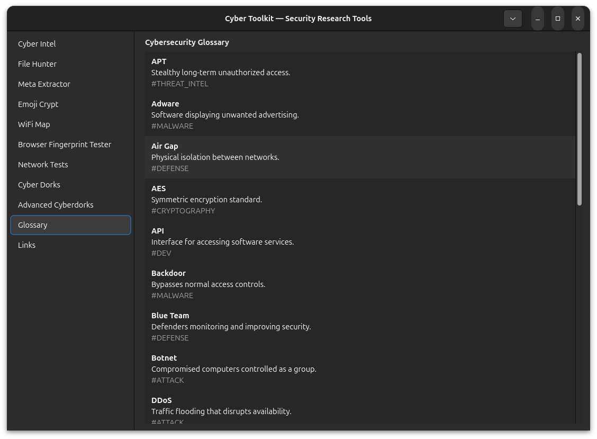

<p align="center">
  
</p>

# Cyber Toolkit

Cyber Toolkit is a GTK4 desktop application for authorized security research, OSINT, and reconnaissance workflows. It brings common search and analysis utilities into one lightweight Linux application.



> Add the application screenshot at `docs/screenshot.png` before publishing the repository.

## Features

- **Cyber Intel** — build Google dork queries for reconnaissance and bug bounty work.
- **File Hunter** — search a target domain for documents by file type.
- **EXIF Metadata** — inspect image metadata locally with ExifTool.
- **Emoji Steganography** — encode and decode data using emoji text.
- **Subfinder** — discover subdomains with ProjectDiscovery Subfinder.
- **Links** — keep useful OSINT and dorking resources close at hand.
- **Built-in resources** — launch network testing and fingerprinting helpers from the application.
- **Native desktop integration** — GTK4 interface, application icon, About dialog, Flatpak metadata, and desktop entry.

Use Cyber Toolkit only on systems and data you own or have explicit permission to test.

## Requirements

- Linux with GTK4 development files
- Vala
- ExifTool for EXIF metadata extraction
- ProjectDiscovery Subfinder for subdomain discovery

On Debian or Ubuntu:

```bash
sudo apt install valac libgtk-4-dev libpango1.0-dev exiftool
```

## Build and run

Build the main application from the repository root:

```bash
./build-linux.sh
./release/cybertoolkit
```

To compile the modular sources directly:

```bash
cd app
valac --pkg gtk4 --pkg gio-2.0 \
  dork_data.vala cyber_tab.vala file_tab.vala \
  exif_reader.vala subfinder_tab.vala exif_tab.vala \
  emoji_tab.vala links_tab.vala app.vala \
  -o cybertoolkit
./cybertoolkit
```

## Flatpak

Install `flatpak`, `flatpak-builder`, and the GNOME SDK/runtime, then run:

```bash
./build-flatpak.sh
flatpak install --user release/CyberToolkit.flatpak
flatpak run com.dorksearch.CyberToolkit
```

If the SDK is missing:

```bash
flatpak remote-add --if-not-exists flathub https://dl.flathub.org/repo/flathub.flatpakrepo
flatpak install flathub org.gnome.Sdk//48 org.gnome.Platform//48
```

## GitHub Releases

To publish a Linux release, create a new release in GitHub and attach these files from `release/`:

- `cybertoolkit` — standalone Linux x86_64 executable
- `cybertoolkit_1.0.0_amd64.deb` — Debian/Ubuntu package
- `fingerprint.html` - required file
- `network_tests.html` - required file

In GitHub:

1. Open **Releases** → **Draft a new release**.
2. Create or select the tag `v1.0.0`.
3. Set the release title to `Cyber Toolkit 1.0.0`.
4. Drag both files from `release/` into the asset upload area.
5. Add release notes, then select **Publish release**.

Users can download the executable directly or install the Debian package with:

```bash
sudo apt install ./cybertoolkit_1.0.0_amd64.deb
```

## Other platforms

Windows builds use MSYS2 MinGW64:

```bash
pacman -S mingw-w64-x86_64-vala mingw-w64-x86_64-gtk4
./build-windows.sh
```

macOS builds use Homebrew:

```bash
brew install vala gtk4
./build-macos.sh
open CyberToolkit.app
```

## Resources

- [DorkSearch Pro](https://dorksearch.pro/index.html)
- [OSINT tools](https://usersearch.org/updates/top-10-rated-osint-tools-from-github)

## License

See [LICENSE](LICENSE).

